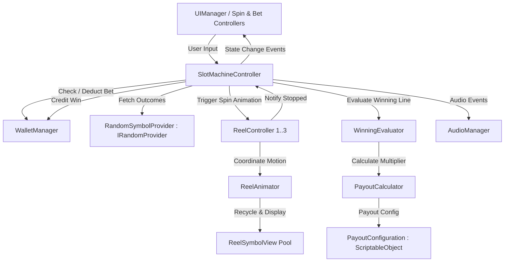
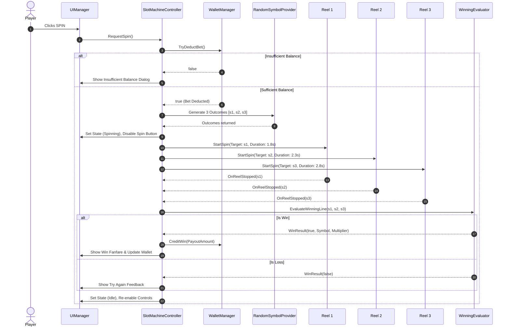

# System Architecture Specification

## 1. Overview & Architectural Principles

The Slot Machine Game is engineered using clean object-oriented architecture in C# for Unity, adhering to SOLID principles, data-driven design with ScriptableObjects, and event-based decoupling.

Key architectural goals:
- **Separation of Concerns**: Gameplay logic, RNG outcome generation, animation state, and presentation (UI/Audio) are strictly separated.
- **Testability**: Core evaluation logic (`WinningEvaluator`, `PayoutCalculator`, `WalletManager`, `RandomSymbolProvider`) has zero coupling to Unity scene GameObjects, allowing both EditMode unit testing and PlayMode integration testing.
- **Zero Allocations During Gameplay**: Reel scrolling uses a recycled view pool rather than instantiating and destroying GameObjects during spins.
- **Determinism for Testing**: The RNG subsystem implements `IRandomProvider`, allowing tests to inject fixed seeds or mock outcomes without altering production behavior.

---

## 2. Subsystem Decomposition

### 2.1 Core Subsystem (`Assets/Scripts/Core/`)
- **`GameState.cs`**: Enum defining state machine transitions (`Idle`, `Spinning`, `Evaluating`, `ShowingWin`, `ShowingLoss`, `InsufficientFunds`).
- **`SlotMachineController.cs`**: High-level coordinator that handles the lifecycle of a spin: validates state, deducts bet, requests 3 outcomes from `IRandomProvider`, launches sequential reel animators, listens for reel completions, evaluates outcomes, triggers payouts, and fires decoupled events.
- **`GameManager.cs`**: Global bootstrap and lifecycle manager holding persistent game settings and connecting audio/wallet persistence.

### 2.2 Gameplay & Logic Subsystem (`Assets/Scripts/Gameplay/`)
- **`IRandomProvider.cs`**: Interface declaring `int NextSymbolIndex(int symbolCount)`.
- **`RandomSymbolProvider.cs`**: Implements `IRandomProvider`. Supports production uniform distribution (`System.Random` initialized with cryptographically varied system seeds) as well as deterministic fixed-seed constructors for automated testing.
- **`WinningEvaluator.cs`**: Pure C# logic evaluator. Checks center payline match conditions (`SymbolId` equivalence across reels 1, 2, and 3).
- **`PayoutCalculator.cs`**: Computes payout amount given bet and winning symbol using a `PayoutConfiguration`.
- **`WalletManager.cs`**: Manages virtual coins: starting balance (default 1000), current bet (default 10), validation against negative balances, bet deduction, win credits, and reset functionality.

### 2.3 Reels & Animation Subsystem (`Assets/Scripts/Reels/`)
- **`ReelSymbolView.cs`**: Component attached to each visual symbol item in the reel strip, displaying the symbol sprite.
- **`ReelAnimator.cs`**: Controls continuous vertical scrolling using coroutines. Features acceleration, steady-state high-speed loop, deceleration, and smooth settle overshoot to target center symbol.
- **`ReelController.cs`**: Manages a single reel's view pool (e.g. 5 recycled views inside a masked aperture), maintains reel index (0, 1, 2), and coordinates stopping sequence with designated stopping delay (Reel 1: ~1.8s, Reel 2: ~2.3s, Reel 3: ~2.8s).

### 2.4 Data Models (`Assets/Scripts/Data/`)
- **`SymbolData.cs`**: Plain C# class defining symbol identity (`SymbolId`, `DisplayName`, `Sprite`, `DefaultMultiplier`).
- **`SymbolDatabase.cs`**: `ScriptableObject` holding registered symbols (Lucky 7, Cherries, Bell, BAR).
- **`PayoutConfiguration.cs`**: `ScriptableObject` mapping each `SymbolId` to its win multiplier.
  - 3 × Lucky 7: **10× Bet**
  - 3 × Cherries: **5× Bet**
  - 3 × Bell: **4× Bet**
  - 3 × BAR: **3× Bet**

### 2.5 Presentation & UI Subsystem (`Assets/Scripts/UI/`)
- **`UIManager.cs`**: Coordinates HUD text displays (Wallet Balance, Current Bet, Last Win, Status Notifications).
- **`SpinButtonController.cs`**: Manages the state of the SPIN button, disabling during active spins.
- **`BetController.cs`**: Handles increase/decrease bet buttons, stepping through configured bet tiers (e.g., 10, 20, 50, 100, 200, 500) and bounds checking.
- **`WinPopupController.cs`**: Displays celebratory modal using `popup.png` on major wins.
- **`ResetDialogController.cs`**: Manages the Reset Wallet confirmation dialog with Yes/No button slices.

### 2.6 Audio Subsystem (`Assets/Scripts/Audio/`)
- **`AudioManager.cs`**: Handles sound playback for spin loop, reel stop tick, win fanfare, and button clicks with mute toggle support. Synthesizes clean procedural audio clips when external WAV assets are not provided, ensuring audio feedback works out-of-the-box.

---

## 3. Spin State Machine Sequence

