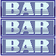

# Slot Machine Deluxe — 2D Unity Game

A complete, polished, professional 2D Slot Machine game built with **Unity 6 (6000.6.7f1)** and **C#**, targeting **WebGL** and **Windows Desktop**.

Features smooth continuous reel animations with realistic settle overshoot, uniform random outcome selection via cryptographically seeded RNG, configurable multi-tier payouts, responsive UI scaling across 16:9 viewports, and zero-allocation object-pooled reels.

---

## 1. Game Overview & Visual Identity

The visual aesthetic preserves the original purple and blue neon casino cabinet art. The layout features:
- **Full-Screen Gradient Background** (`bg_gradient.png`)
- **Central Mechanical Cabinet** (`slot-machine4.png`) with recessed aperture, cavity shadow plate (`slot_machine_Middle_box.png`), and glossy glass reflection overlay (`slot-machine5.png`)
- **Three Scrolling Reels** with masked viewport clipping (`RectMask2D`)
- **Four Classic Slot Symbols**: Lucky 7, Cherries, Bell, BAR
- **Interactive Control Console**: Circular animated SPIN button (`slot_machine_buttons-02`), Bet Decrement (`slot_machine_buttons-03`), and Bet Increment (`slot_machine_buttons-04`)
- **Celebration & Dialog Modals**: Major win banner (`popup.png`) and reset confirmation with sliced action buttons (`Yes_No_Btn.png`)
- **Procedural Sound Effects**: Synthesized audio feedback for spin loop, reel stop tick, win fanfare, and button clicks with a sound toggle

---

## 2. Key Features

- **Object-Oriented Architecture**: Clean separation between presentation (`ReelController`, `UIManager`), gameplay state machine (`SlotMachineController`), and evaluation logic (`WinningEvaluator`, `PayoutCalculator`, `WalletManager`).
- **Smooth Continuous Reel Motion**: High-speed vertical conveyor animation with smooth acceleration, sustained loop, deceleration, and settle bounce/overshoot physics upon stopping.
- **Sequential Reel Cadence**:
  - Reel 1 settles at ~1.8 seconds
  - Reel 2 settles at ~2.3 seconds
  - Reel 3 settles at ~2.8 seconds
- **Zero Allocations During Spins**: Symbol views are recycled in a conveyor pool (`ReelSymbolView`) rather than instantiating or destroying GameObjects at runtime.
- **RNG Independence & Fairness**: Dedicated `RandomSymbolProvider` implementing `IRandomProvider`, ensuring uniform distribution across all 4 symbols with support for fixed deterministic seeds during automated testing.
- **Configurable Virtual Economy**:
  - Starting wallet balance: **1,000 Coins**
  - Configurable bet tiers: **10, 20, 50, 100, 200, 500 Coins**
  - Guaranteed non-negative balance protection
  - Automated low-balance detection and wallet reset confirmation
- **Data-Driven Configuration**: Multipliers and symbol data are externalized into `ScriptableObject` assets (`PayoutConfiguration.asset`, `SymbolDatabase.asset`).
- **Complete Test Suite**: 26 automated unit and integration tests (22 EditMode + 4 PlayMode) covering payline combinations, payout accuracy, bet bounds, wallet invariants, and RNG uniformity.
- **Production WebGL Build**: Ready-to-play WebGL build included in the repository at `Build/WebGL/`.

---

## 3. Winning Conditions & Payout Table

### Winning Condition
All three slot reels must display the **exact same symbol on the center payline** when all reels have come to a complete stop.

| Symbol | Name | Center Combination | Payout Multiplier | Example (Bet = 10) | Example (Bet = 100) |
| :---: | :---: | :---: | :---: | :---: | :---: |
|  | **Lucky 7** | `[ 7 ] [ 7 ] [ 7 ]` | **10× Bet** | 100 Coins | 1,000 Coins |
|  | **Cherries** | `[ 🍒 ] [ 🍒 ] [ 🍒 ]` | **5× Bet** | 50 Coins | 500 Coins |
|  | **Bell** | `[ 🔔 ] [ 🔔 ] [ 🔔 ]` | **4× Bet** | 40 Coins | 400 Coins |
|  | **BAR** | `[ BAR ] [ BAR ] [ BAR ]` | **3× Bet** | 30 Coins | 300 Coins |
| *Mixed* | *Any mismatch* | e.g. `[ 7 ] [ 🍒 ] [ 7 ]` | **0× (Loss)** | 0 Coins | 0 Coins |

---

## 4. Technology Stack

- **Game Engine**: Unity 6 (Version `6000.6.7f1`)
- **Language**: C# (.NET Standard 2.1)
- **UI Framework**: Unity UI (uGUI) with TextMeshPro
- **Target Platforms**: WebGL (WebAssembly / asm.js) & Windows Standalone (x86_64)
- **Testing Framework**: Unity Test Framework (NUnit 3.5)
- **Audio**: Procedural synthesis via `AudioClip.Create` + AudioSource

---

## 5. Project Structure

```
SlotMachineGame/
|
|-- Assets/
|   |-- Art/
|   |   |-- ProvidedAssets/        # Original extracted assets from Slot Machine.zip
|   |   |-- ImportedSprites/       # Sliced and configured 2D sprites
|   |
|   |-- Scripts/
|   |   |-- Core/                  # GameManager, SlotMachineController, GameState
|   |   |-- Reels/                 # ReelController, ReelAnimator, ReelSymbolView
|   |   |-- Gameplay/              # IRandomProvider, RandomSymbolProvider, WinningEvaluator,
|   |   |                          # PayoutCalculator, WalletManager
|   |   |-- Data/                  # SymbolData, SymbolDatabase, PayoutConfiguration
|   |   |-- UI/                    # UIManager, SpinButtonController, BetController,
|   |   |                          # WinPopupController, ResetDialogController
|   |   |-- Audio/                 # AudioManager (procedural synthesis & SFX routing)
|   |   |-- SlotMachineGame.asmdef # Runtime assembly definition
|   |
|   |-- Editor/
|   |   |-- SlotGameAssetImporter.cs    # Automated sprite import and slicing
|   |   |-- SlotGameSceneBuilder.cs     # Programmatic scene builder
|   |   |-- SlotGameBuildScript.cs      # Automated WebGL & Desktop build pipeline
|   |   |-- SlotMachineGame.Editor.asmdef
|   |
|   |-- ScriptableObjects/
|   |   |-- SymbolDatabase.asset        # Registered symbols metadata
|   |   |-- PayoutConfiguration.asset   # Configurable win multipliers
|   |
|   |-- Scenes/
|   |   |-- SlotMachineScene.unity      # Main playable game scene
|
|-- Build/
|   |-- WebGL/                     # Complete playable WebGL build
|       |-- index.html
|       |-- Build/                 # WebGL.wasm.gz, WebGL.data.gz, loader & framework
|       |-- TemplateData/          # Styles and icons
|
|-- Documentation/
|   |-- ASSET_ANALYSIS.md          # Dimensions, bounding boxes, slicing matrix, GIF timing
|   |-- ARCHITECTURE.md            # Subsystem breakdown, class diagrams, sequence flows
|   |-- TESTING.md                 # Test plan, requirement coverage matrix, runner commands
|
|-- Tests/
|   |-- EditMode/                  # Unit tests (WinningEvaluator, Payout, Wallet, RNG)
|   |-- PlayMode/                  # Integration tests (SlotMachineController coroutines & state)
|   |-- EditModeResults.xml        # Verified test run results (22 passed)
|   |-- PlayModeResults.xml        # Verified test run results (4 passed)
|
|-- Packages/                      # Unity 6 package manifest (uGUI, Test Framework, etc.)
|-- ProjectSettings/               # Engine settings, tags, layers, and build configurations
|-- serve_webgl.py                 # Lightweight HTTP server for testing WebGL locally
|-- README.md                      # This comprehensive documentation
|-- .gitignore                     # Standard Unity gitignore (tracks WebGL build)
```

---

## 6. How to Run the WebGL Build

The repository includes the fully compiled WebGL player inside `Build/WebGL/`.

Because modern browsers enforce Cross-Origin Resource Sharing (CORS) and WebAssembly security restrictions, opening `index.html` directly via `file:///` is blocked by browser security. Use any local HTTP server:

### Option A: Using the Included Python Server (Recommended)
From the project root directory, run:
```bash
python serve_webgl.py
```
Then navigate to: **[http://localhost:8080](http://localhost:8080)** in Chrome, Firefox, Edge, or Safari.

### Option B: Using Node.js `npx serve`
```bash
npx serve Build/WebGL -p 8080
```

### Option C: Using Python `http.server`
```bash
python -m http.server 8080 --directory Build/WebGL
```

---

## 7. How to Open and Play in Unity Editor

1. Open **Unity Hub**.
2. Click **Add > Add project from disk**.
3. Select this folder: `C:\Users\rahul\Code\SlotMachineGame`.
4. Ensure the editor version is set to **Unity 6 (6000.6.7f1)** (or any compatible Unity 6 release).
5. Open the project.
6. In the **Project** window, navigate to `Assets/Scenes/` and double-click **`SlotMachineScene.unity`**.
7. Press the **Play** button at the top of the Unity Editor.

### Editor Automation Menu
The project provides one-click automation under the top menu bar **`SlotMachine`**:
- **`SlotMachine > Import & Configure All Assets`**: Reimports sprites, configures slice grids, and links ScriptableObjects.
- **`SlotMachine > Build Playable Scene`**: Regenerates `SlotMachineScene.unity` from scratch with all UI and script bindings.
- **`SlotMachine > Build WebGL`**: Generates a fresh WebGL production build into `Build/WebGL/`.
- **`SlotMachine > Build Windows Standalone`**: Generates a 64-bit Windows `.exe` into `Build/Windows/`.

---

## 8. How to Play

1. **Select Bet**: Use the **`<` (Decrease)** and **`>` (Increase)** buttons to adjust your wager between 10 and 500 coins.
2. **Spin**: Click the circular teal **SPIN** button.
   - The bet is validated and deducted from your wallet balance.
   - The three reels spin smoothly and stop sequentially.
3. **Outcome**:
   - If all 3 reels align on the center payline with matching symbols, your win is calculated according to the payout table, credited to your wallet, and celebrated with a victory banner and fanfare.
   - If symbols differ, the notification updates with "TRY AGAIN!".
4. **Sound Control**: Click the **`SOUND: ON/OFF`** toggle button to mute or unmute audio at any time.
5. **Reset Game**: Click the **`RESET GAME`** button and confirm "YES" to reset your coin balance back to the starting 1,000 coins.

---

## 9. Automated Testing & Verification

Automated test execution was conducted using the **Unity Test Runner** in batch mode.

### Test Results Summary

| Test Suite | Mode | Total Tests | Passed | Failed | Status |
| :--- | :--- | :---: | :---: | :---: | :---: |
| `PayoutCalculatorTests` | EditMode | 7 | 7 | 0 | **PASSED** |
| `RandomSymbolProviderTests`| EditMode | 4 | 4 | 0 | **PASSED** |
| `WalletManagerTests` | EditMode | 8 | 8 | 0 | **PASSED** |
| `WinningEvaluatorTests` | EditMode | 3 | 3 | 0 | **PASSED** |
| `SlotMachineControllerTests`| PlayMode | 4 | 4 | 0 | **PASSED** |
| **TOTAL** | **All** | **26** | **26** | **0** | **100% PASS** |

### Running Tests via Command Line
```powershell
# Run EditMode Tests
& "C:\Program Files\Unity\Hub\Editor\6000.6.7f1\Editor\Unity.exe" `
  -batchmode -projectPath . -runTests -testPlatform EditMode `
  -testResults "Tests/EditModeResults.xml" -logFile "test_editmode.log"

# Run PlayMode Tests
& "C:\Program Files\Unity\Hub\Editor\6000.6.7f1\Editor\Unity.exe" `
  -batchmode -projectPath . -runTests -testPlatform PlayMode `
  -testResults "Tests/PlayModeResults.xml" -logFile "test_playmode.log"
```

---

## 10. Original Asset Credits & Attribution

All visual assets originate from the supplied `Slot Machine.zip` archive:
- **Cabinet & Frame Layers**: `slot-machine1.png` through `slot-machine5.png`
- **Reel Symbols**: `slot-symbol1.png` (Lucky 7), `slot-symbol2.png` (Cherries), `slot-symbol3.png` (Bell), `slot-symbol4.png` (BAR)
- **Housing & UI Plates**: `slot_machine_Middle_box.png`, `bg_gradient.png`, `popup.png`
- **Button Sprite Sheets**: `slot_machine_buttons-02.png` (Spin), `slot_machine_buttons-03.png` (Bet -), `slot_machine_buttons-04.png` (Bet +), `Yes_No_Btn.png` (Dialog actions)
- **Animation Reference**: `4tXlXs.gif` (85-frame visual timing reference)

Detailed inspection metrics, bounding boxes, and alpha analysis are preserved in [`Documentation/ASSET_ANALYSIS.md`](Documentation/ASSET_ANALYSIS.md).

---

## 11. Known Limitations & Notes

- **Browser Audio Autoplay**: Modern web browsers (Chrome, Edge, Safari) require user interaction (e.g. clicking the Spin or Bet button) before allowing Web Audio playback. The game gracefully supports this standard policy.
- **WebGL Fullscreen**: Fullscreen mode is toggled via the footer icon or browser F11 fullscreen shortcut.

